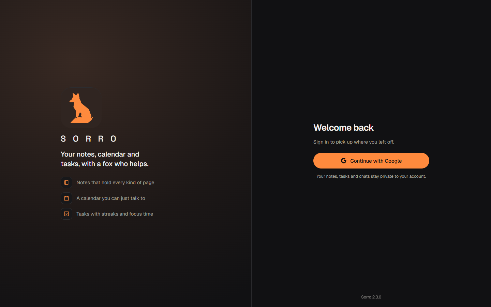
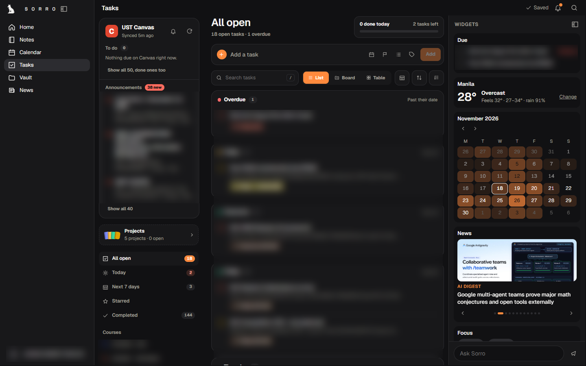
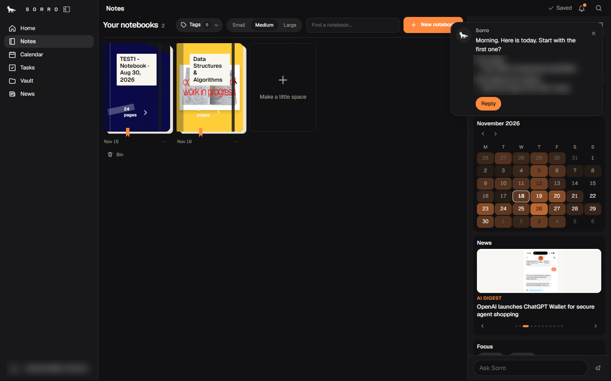
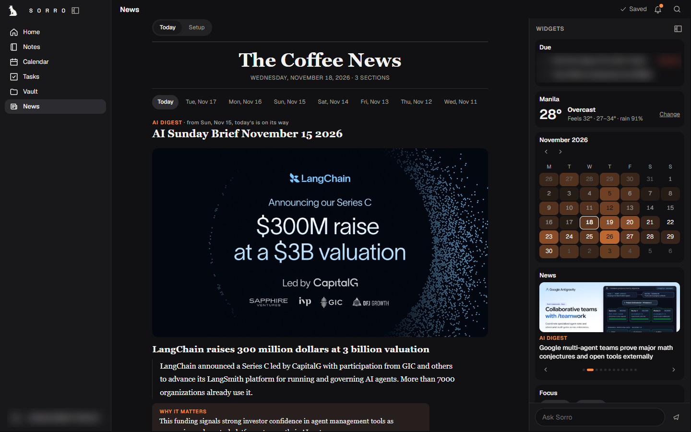
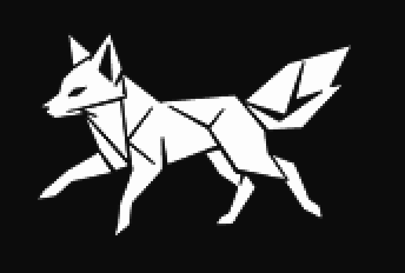

# S O R R O

**Your notes, calendar and tasks, with a fox who helps.**

Sorro is a personal workspace for students. It keeps notes, a calendar and a to-do list in one place, and Sorro the fox, an AI assistant, can read and update all three when you ask in plain words.

## Screens

<table>
  <tr>
    <td width="50%"> <b>Tasks</b>: grouped by due date, with streaks and focus time.</td>
    <td width="50%"> <b>Notes</b>: notebooks as covers, with the fox's morning brief.</td>
  </tr>
  <tr>
    <td colspan="2"> <b>News</b>: a daily edition to read over coffee.</td>
  </tr>
</table>

## What's inside

| | |
|---|---|
| **Home** | Ask Sorro to plan your day, add events or find a note. Every change can be undone. |
| **Notes** | Notebooks that hold documents, flashcards, whiteboards, checklists and PDFs. |
| **Calendar** | Type "lunch with Ana fri 1pm" and it lands on the right day. |
| **Tasks** | List, board and table views, streaks and a focus timer. |
| **Vault** | One shelf for saved links and files. |
| **News** | A short daily paper, plus a Monday recap of your week. |

Works offline, in light or dark, on the web, Android and Windows.

  
  
  
  

